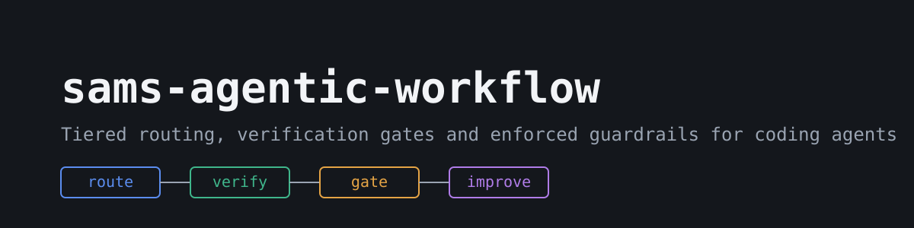
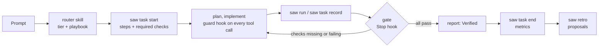

<p align="center"></p>

# sams-agentic-workflow

A Claude Code plugin and a small CLI (`saw`) that make a coding agent route each task by risk, prove its work with real checks, and stay inside guardrails enforced by hooks rather than by instructions.

- **Set it up with an agent:** [docs/STARTUP.md](docs/STARTUP.md) (one prompt, plus a manual path) 
- Set up wizard command and quick start can specify globally, project based, and list out full command set up via /workflow-setup 
- **Every command, setting and recipe:** [docs/COMMANDS.md](docs/COMMANDS.md)

## The problem

Coding agents treat a typo and a payment migration the same way, say "done" before anything ran, and follow safety rules only as long as they remember them. Instructions in `CLAUDE.md` are advice; nothing checks them.

## How it works

Every task goes through the `router` skill. It picks a **tier** (trivial, standard, complex, critical) and a **playbook** (feature, debug, design, ...), and opens the task with `saw task start`, which prints the steps and the checks that tier needs. The agent runs those checks with `saw run` and records judgement checks (reviews, threat models) with `saw task record`. A Stop hook, the **gate**, blocks "done" until the tier's checks pass. Another hook, the **guard**, checks every shell command and file edit against your safety and autonomy settings before it runs. When the task closes, its outcome goes to `.saw/metrics.jsonl`, and `saw retro` turns checks that keep failing into proposals for a fix.



## Two parts

| | Claude Code plugin | `saw` CLI |
|---|---|---|
| What | skills (`router`, `saw-settings`, `retro-promote`), playbooks, review agents, hooks | a dependency-free TypeScript CLI run with bun |
| Role | shapes what the agent does | holds settings, records evidence, enforces rules from the hooks |
| Installed by | `bootstrap.sh` / `bootstrap.ps1`, or `claude plugin install` | the clone, with `bin/` on your PATH |
| Without the other | skills load, but hooks have nothing to call | works, but no hook runs: nothing is guarded or gated |

You need both for enforcement. `saw` alone is still useful for `saw init`, settings and checks.

## Why use it

- Small tasks stay cheap: a trivial task runs the tests and stops; the full process is for complex and critical work.
- "Done" means the checks ran. The gate reads recorded results, not the agent's summary.
- Guardrails live in hooks. A committed `workflow.toml` can tighten them but never loosen them, so a cloned repo can't unlock pushes on your machine.
- Settings are layered and validated: `saw explain <key>` shows which layer set a value and why another was ignored.
- Improvement is driven by evidence: metrics per task, a dashboard, proposals from repeated failures, and an eval suite to compare before and after.

## Features

Defaults are what a fresh `saw init` gives you. "Key" is the setting that controls it. Optional extras need the external dependency installed first.

| Category | Feature | Default | Key | Needs |
|---|---|---|---|---|
| Routing | Tier + playbook per task, `saw task start` steps | on | `[routing]` | plugin |
| | Grilling (clarifying questions) on complex and critical | on | `features.grilling`, `routing.always_grill` | |
| | Test-first step | on | `features.tdd` | |
| Verification | Mechanical checks, quiet output, full logs kept | on | `[checks]`, `[output]` | your commands |
| | Required checks per tier (tiers can `extends`) | on | `[verify]` | |
| | Gate: block "done" until checks pass | on | `features.verify_hook` | plugin |
| | Format after each edit | on (needs `checks.format`) | `features.format_hook` | |
| | Docs step on feature and foundation tasks | on | `features.docs_step` | `engineering` plugin (installed by bootstrap) |
| | Living docs: flag blank docs and reference drift at task end; docs step on debug/integration/hardening | on | `features.living_docs` | |
| | Review reports required for a review pass | off | `verify.require_review_evidence` | |
| Reviews | Code and security review on standard+ | on | `features.code_review`, `features.security_review` | |
| | Review agents (code, security, architecture, UI, research) | on | `[models.roles]` | plugin |
| | Independent read-only review session per unit | off | `[review_session]` | `claude` CLI |
| | Whole-project auditors on chosen triggers | on | `features.audit`, `[audit]` | auditor skills |
| Safety | Guard hook: deny-list, push, destructive and deploy approval, no secrets | on | `[safety]` | plugin |
| | Autonomy per action (commit, push, PR, deps, sessions, global edits) | propose / ask | `[autonomy]` | plugin |
| Context and tokens | Token budget per tier (`soft` warns, `hard` stops) | soft | `features.budgets`, `[tokens]` | |
| | `/compact` and handoff nudges | on | `features.compact_nudge`, `[context]` | |
| | Model per agent role | routed | `[models]` | |
| | Reply tone and word cap, checked on Stop | on | `features.style_hook`, `[style]` | |
| | Trail code map in task steps | off | `features.trail` | Trail CLI |
| Sessions | One session per phase, stage or feature | soft | `[sessions]` | |
| | Worktree per complex task | on | `features.worktrees` | |
| | Split a task across sessions | off | `features.parallel_sessions` | |
| | Implementer agent writes planned units | off | `features.implementer` | |
| UI and launch | unslop UI polish in the design playbook | off | `features.unslop` | unslop skill |
| | Launch video after feature PRs | off | `features.brag` | brag skill, Hyperframes |
| | ECC context and verification skills | off | `features.ecc` | ECC plugin |
| Knowledge | `docs/` vault (decisions, learnings, plans, features) | on | `saw init` | |
| | Central personal vault index | on (needs `vault_path`) | `features.obsidian`, `[knowledge]` | |
| Metrics | Per-task metrics and event log | on | `features.metrics`, `[logging]` | |
| | Static or live dashboard | on | `features.dashboard`, `[dashboard]` | |
| | Retro proposals and settings suggestions | on | `features.retro`, `[retro]` | |
| | Eval suite with baseline comparison | manual | `[evals]` | `claude` CLI |
| Agents | `AGENTS.md` for Codex, Cursor, Gemini CLI | claude only | `[agents]` | |
| GitHub | Repo settings as code (`saw repo plan/apply`) | off | `[repo]` | `gh` |
| Supply chain | Pinned third-party skills, licence check | on | `[deps]` | |
| Release | `saw sanitize` for secrets, paths, emails, names | manual | `[release]` | |
| Automation | Autopilot: approved queue, one headless session + PR per item | off | `[autopilot]` | `claude` CLI, `gh` |

Details for every key: [docs/COMMANDS.md](docs/COMMANDS.md#configuration-keys).

## Prerequisites

| Tool | Check | Needed for |
|---|---|---|
| [bun](https://bun.sh) 1.3+ | `bun --version` | the `saw` CLI (don't substitute npm or node) |
| git | `git --version` | everything |
| [Claude Code](https://claude.com/claude-code) | `claude --version` | the plugin, review sessions, evals, autopilot |
| `gh` (optional) | `gh --version` | `saw repo`, `saw task report --post`, autopilot PRs |

## Install

There are two scopes. **Global** installs the plugin and the workflow rules for every Claude Code session on this machine. **Project** adds `workflow.toml`, `AGENTS.md` and the `docs/` vault to one repo. Most people do both. Every step has a dry run; run it first.

### 1. Clone and put `saw` on your PATH

Clone somewhere permanent: the plugin and `saw` run from this folder.

macOS / Linux:

```bash
git clone https://github.com/sam-ash-cy/sams-agentic-workflow.git ~/sams-agentic-workflow
export PATH="$HOME/sams-agentic-workflow/bin:$PATH"   # also add to ~/.bashrc or ~/.zshrc
saw doctor --no-plugin
```

Windows PowerShell:

```powershell
git clone https://github.com/sam-ash-cy/sams-agentic-workflow.git "$HOME\sams-agentic-workflow"
[Environment]::SetEnvironmentVariable("Path", [Environment]::GetEnvironmentVariable("Path", "User") + ";$HOME\sams-agentic-workflow\bin", "User")
# open a new terminal, then:
saw doctor --no-plugin
```

Without the PATH entry, run `bun ~/sams-agentic-workflow/cli/src/main.ts` wherever these docs say `saw`.

### 2. Global setup (once per machine)

The bootstrap script, in `~/.claude` (or `$CLAUDE_CONFIG_DIR`):
1. copies `global/CLAUDE.md` to `saw-workflow.md` and adds an `@saw-workflow.md` line to `CLAUDE.md`
2. copies `global/settings.example.json` to `settings.json` only if there is none (otherwise prints `kept:` and leaves merging to you)
3. adds this folder as a plugin marketplace and installs the `sams-agentic-workflow` plugin, which pulls in the pinned `mattpocock-skills` and `engineering` plugins

It never overwrites without a backup (`*.bak.<timestamp>`).

```bash
cd ~/sams-agentic-workflow
sh bootstrap.sh --dry-run
sh bootstrap.sh
```

```powershell
cd "$HOME\sams-agentic-workflow"
.\bootstrap.ps1 -DryRun
.\bootstrap.ps1
```

Set `SAW_NO_PLUGIN=1` to skip the plugin step, or `SAW_WITH_ECC=1` to also install ECC. If it prints `skip: plugin install (claude not on PATH)`, fix `claude --version` in that terminal and run it again; finished steps are skipped.

It worked when `claude plugin list` shows the three plugins enabled and `saw doctor` ends with `saw doctor: ok`.

### 3. Project setup

In the root of a git repo:

```bash
saw init --dry-run
saw init
saw config set checks.test "bun test"      # your real commands
saw doctor --hooks
```

`saw init` adds `workflow.toml`, `AGENTS.md`, `CLAUDE.md` (importing `AGENTS.md`), the `docs/` vault, a CI workflow and a pre-commit hook file, and gitignores `workflow.local.toml` and `.saw/`. Existing files are kept unless you pass `--force` (which backs them up). See [`saw init`](docs/COMMANDS.md#setup) for `--type`, `--hooks`, `--agents` and `--repo`.

**Project-only plugin.** To enable the plugin for one repo instead of user-wide (teammates get it from the committed `.claude/settings.json`), use the URL, not a local path:

```bash
claude plugin marketplace add https://github.com/sam-ash-cy/sams-agentic-workflow.git --scope project
claude plugin install sams-agentic-workflow@sams-agentic-workflow --scope project
claude plugin install mattpocock-skills@sams-agentic-workflow --scope project
claude plugin install engineering@sams-agentic-workflow --scope project
```

Each developer still needs `saw` on their PATH for the hooks to run.

## Updating

```bash
cd ~/sams-agentic-workflow
git pull
claude plugin marketplace update sams-agentic-workflow
sh bootstrap.sh            # or .\bootstrap.ps1; refreshes saw-workflow.md, backing up the old one
```

Then in each project:

```bash
saw init --upgrade --dry-run
saw init --upgrade
```

Template files you haven't edited are updated; edited ones are listed as `kept (edited)` for you to merge.

### Release channels and pinning

Releases are tagged `vX.Y.Z` (pre-releases `vX.Y.Z-beta.N`) and listed on the GitHub Releases page with notes from [CHANGELOG.md](CHANGELOG.md). Pick what you track with the ref after `#` when you add the marketplace:

| Channel | Add the marketplace with | `marketplace update` moves to |
|---|---|---|
| Stable (recommended) | `https://github.com/sam-ash-cy/sams-agentic-workflow.git#stable` | each final release |
| Beta | `...sams-agentic-workflow.git#beta` | every release, betas included |
| Pinned | `...sams-agentic-workflow.git#v0.1.0` | nothing; re-add at a new tag to upgrade |
| Edge | `...sams-agentic-workflow.git` | every commit on `main` |

To switch, `claude plugin marketplace remove sams-agentic-workflow`, add it again with the new ref, then `claude plugin marketplace update sams-agentic-workflow`. With a local clone, `git checkout stable` (or a tag) instead of `git pull` on `main`. Run `saw doctor` afterwards; it flags manifests whose versions disagree.

## Uninstalling

**Project.** Removes only template files you haven't edited:

```bash
saw uninstall --dry-run
saw uninstall
```

`workflow.local.toml`, `.saw/`, the `.gitignore` lines, agent adapters and `core.hooksPath` stay; remove them by hand if you want (`git config --unset core.hooksPath`).

**Global.**

```bash
claude plugin uninstall sams-agentic-workflow@sams-agentic-workflow
claude plugin prune
claude plugin marketplace remove sams-agentic-workflow
```

Then remove the `@saw-workflow.md` line from `~/.claude/CLAUDE.md`, delete `~/.claude/saw-workflow.md` (and its `.bak.*` copies), `~/.saw/` if you don't want your personal settings, the clone, and the PATH entry. Don't delete `~/.claude/settings.json`: it holds your other Claude Code settings. If the bootstrap created it, compare it with `global/settings.example.json` and remove only what came from there.

## Configuration

Settings come from four layers; later layers win.

| Layer | File | Committed | Use it for |
|---|---|---|---|
| default | built in (`cli/src/defaults.ts`) | n/a | every key has one |
| global | `~/.saw/config.toml` (`$SAW_HOME`) | no | your defaults for every project |
| project | `workflow.toml` | yes | the team's settings for this repo |
| local | `workflow.local.toml` | no (gitignored) | your settings for this repo |

A per-command `--set key=value` overrides all four for that one call.

Rules the CLI enforces:
- **Guardrails only tighten from `workflow.toml`.** For `safety.*`, `autonomy.*`, `features.worktrees`, `features.parallel_sessions` and `verify.require_review_evidence`, a project value looser than the default is ignored with a warning. Loosen them in global or local. `safety.deny` from the project is added to, never replaced.
- **Personal values never come from `workflow.toml`:** `knowledge.vault_path` and `release.names`.
- **The agent can't quietly change its guardrails:** `saw config set` on a guarded key, or an edit to a `workflow*.toml`, asks you first.

```bash
saw config set style.tone structured --scope global
saw config set autonomy.actions.commit allow --scope local
saw explain autonomy.actions.commit
saw doctor
```

Ready-made profiles (`saw profile apply solo|team|strict|autopilot`) and goal recipes are in [docs/COMMANDS.md](docs/COMMANDS.md#recipes).

## Trail (strongly recommended)

[Trail](https://www.npmjs.com/package/@trailhq/trail-code) builds a code map of the repo so the agent finds code with ranked lookups and file skeletons instead of reading whole files. It cuts tokens noticeably on anything beyond a small repo. saw doesn't bundle it.

Two separate things:
- **Installing Trail** gives you the `trail` CLI and, after `trail init`, its hooks and index in that repo.
- **`features.trail`** only tells saw to add "trail ask/skeleton before reading code" to each task's steps. Turning it on without Trail installed just gives the agent a step it can't follow.

Install and enable:

```bash
bun add -g @trailhq/trail-code          # or: npm install -g @trailhq/trail-code --ignore-scripts
trail init --agents claude              # in each repo
saw config set features.trail true --scope local
```

Verify: `trail --version` prints a version, the repo has a `.trail/` folder, and `saw task start --tier standard --playbook feature` lists the Trail step. Opt out with `saw config set features.trail false --scope local`; without Trail, `saw outline <file>` gives signatures with line numbers.

## Third-party skills

saw doesn't copy these into the repo. They are pinned by commit in `deps.lock.toml` and keep their own licences:
- [mattpocock/skills](https://github.com/mattpocock/skills) (MIT), installed as a plugin dependency
- [unslop](https://github.com/heydamir/unslop) by Damir Sokolovsky (CC BY 4.0), optional UI polish (`features.unslop`)
- [brag](https://github.com/latent-spaces/brag) by Shunit Haviv Hakimi (MIT), optional launch videos (`features.brag`). Its bundled music is CC BY 4.0 by [Sascha Ende](https://ende.app): credit him wherever you publish a video made with it.
- [ECC](https://github.com/affaan-m/ECC) by Affaan Mustafa (MIT), optional plugin (`features.ecc`). saw recommends turning off its duplicate hooks; see [optional extras](docs/COMMANDS.md#optional-extras).

Tests: `bun test`. Licence: [MIT](LICENSE).
