# sams-agentic-workflow: redesigned blueprint

> **Phase 1 update:** [ADR 0012](decisions/0012-phase-1-revisions.md) replaces several custom pieces below with built-in Claude Code features: plugin `dependencies`, `bin/`, hooks.json, agent frontmatter, `claude plugin eval`, LSP plugins. Where the two disagree, the ADR wins.

## Context
Your setup works, but it is scattered across `~/.claude`, the 38 skills and aws-security-lab's conventions, and it isn't reproducible. The first proposal also had too much process: Bloom steps, a long list of new skills, custom installers. This blueprint keeps what works (the staged roadmap, the PR gate, mechanical enforcement) and composes existing pinned tools. It adds three things: routing by task tier, verification as a first-class step, and self-improvement driven by evidence. Everything is configurable.

## Decisions (settled by grilling)
| # | Decision |
|---|---|
| Q1 | Compose on **mattpocock-skills** + **rederive** (pinned SHAs). Delete my overlapping skills (plan, orchestrator, debugging, research, session-handoff, code-review-checklist) after their eval cases pass with the replacements. |
| Q2 | **Both** a Claude Code plugin marketplace (primary) and the `npx skills`-compatible layout for other agents. A tiny bootstrap handles global files. |
| Q3/Q10 | Any agent and any OS, **tiered**. Tier 1, tested by CI evals: Claude Code and Codex. Tier 2, smoke-tested install only: Cursor and Gemini. Gates are enforced through git hooks and CI so they work in every agent. |
| Q4 | A router auto-classifies each task as trivial, standard, complex or critical, picks a playbook, and states it in one line. You can override it. |
| Q6 | Trail is an **optional adapter** (`memory.trail`): on in your local profile, off by default for everyone else. |
| Q7/Q11 | `autonomy.level = suggest | propose | act` (default **propose**), plus per-action overrides: self_improve, spawn_sessions, worktrees, commit, push, open_pr, add_dependency, edit_global. Precedence: framework defaults < global < project < `workflow.local.toml` (git-ignored). |
| Q8/Q9 | Obsidian is core. `knowledge.store = repo | vault | both`, default **repo**: the project's `docs/` is itself an Obsidian-compatible vault (wikilinks, frontmatter). An optional central personal vault indexes all your projects and holds cross-project learnings. `both` is allowed but warns about drift. |
| Q12/Q14 | Metrics go to `.saw/metrics.jsonl`. `saw dashboard` renders a self-contained static HTML page. Panels are configurable in `[dashboard]`, with an optional Obsidian note export. |
| Q13 | The CLI `saw` is TypeScript, run with bun or node (`bunx saw …`). The only per-OS scripts are a ~10-line bootstrap in `.ps1` and `.sh`. |
| Always | **grilling** (mattpocock) runs at the start of every complex or critical task, and of every stage plan; `/code-review` and `/security-review` run on every feature. |

## Architecture

```mermaid
flowchart LR
  U[You] --> R[Router skill: tier + playbook]
  R -->|trivial| IMP
  R -->|standard| PL[Plan: acceptance criteria]
  R -->|complex/critical| G[grilling] --> RS[research subagent] --> AR[Architect: options + trade-offs] --> IR[Independent architecture reviewer subagent] --> ADR[ADR] --> PL
  PL --> IMP[Implement: tdd, small units, worktree if parallel]
  IMP --> V[Verify: deterministic checks via hooks/CI]
  V --> CR[Independent code-review + security-review subagents]
  CR -->|findings| IMP
  CR --> REP[Report: Verified / Partial / Not verified / Blocked]
  REP --> RET[Retro: metrics.jsonl + learnings]
  RET -->|repeated >=2| PROP[Proposal: lint/test > hook > skill edit > CLAUDE.md rule, + eval case]
  PROP -->|autonomy gate| U
  K[(Knowledge: docs/ vault, ADRs, glossary, learnings; Trail optional)] -.-> R & AR & IMP
```

- **Deterministic** (CLI, hooks, CI): config resolution, checks, format/lint/type/test/security scans, architecture fitness tests, metrics capture, the dashboard, install, and evals.
- **Agent-directed**: classification, design, implementation, review judgement, re-planning. The agent re-plans when an assumption fails. It doesn't keep following a broken plan.
- **Subagents only where they add independence or isolate context**: research, the architecture reviewer, the code reviewer, the security reviewer, and the UI verifier (browser). There are no persona teams, and the implementer stays in the main session.

## Tiers → lifecycle
Every tier shares one lifecycle: **Classify → (Discover) → Plan → Implement → Verify → Review → Report → Retro**. The tier decides how deep each step goes.

| Tier | Example | Path | Human gates |
|---|---|---|---|
| Trivial | typo, config tweak | implement → relevant checks → report | none |
| Standard | normal feature or bug | acceptance criteria → tdd → full checks → code + security review → PR | the PR |
| Complex | new subsystem or integration | grilling → research → 2–3 options → independent review → ADR → staged plan → standard path per unit | design approval, then the PR |
| Critical | auth, infra, data migration, prod | complex path + appsec threat model + rollback plan + the hardening playbook | design, plan and PR, plus any deploy |

**Playbooks** add gates to the lifecycle; they are not separate workflows. There are seven:
- `foundation` (stage 0: discovery, not invented decisions)
- `design` (UI)
- `feature`
- `integration`
- `debug` (diagnosing-bugs: reproduce first)
- `spike` (prototype + research → ADR, no merge)
- `hardening` (security, perf, deps, release)

`refactor` folds into `feature`, with the rule "behaviour unchanged, `trail callers` / impact map first". `migration` and `infra` are critical-tier variants of `integration`. Each playbook file defines its entry criteria, its extra gates, its outputs and its definition of done.

**Verification rule:** a check counts as passed only if it ran in this session and its output was observed. The report labels each check Verified, Partially verified, Not verified (with the reason) or Blocked. A Stop hook blocks a "done" claim when the configured checks have not run. Per-tier check sets live in `[verify]`.

## Memory
| Kind | Where | Lifecycle |
|---|---|---|
| Global instructions | plugin `CLAUDE.md`/`AGENTS.md` fragment, ≤150 lines | Changes only by PR |
| Project architecture and conventions | `AGENTS.md` (short) + `docs/conventions.md`, enforced by tests | Updated each stage |
| Decisions | `docs/decisions/NNNN-*.md` (ADR) | Never edited; superseded instead |
| Features | `docs/features/*.md` | Written when the feature ships |
| Task state | `docs/plans/stage-n.md` / tickets | Archived after merge |
| Operational learnings | `docs/learnings/*.md` (or Trail) | Decided / ruled out / watch out |
| Personal preferences | auto-memory / `workflow.local.toml` / vault | Never in public repos |

`saw memory lint` finds:
- duplicate learnings (similarity)
- learnings that contradict an ADR (asks the agent to judge)
- stale references to files or symbols that no longer exist
- oversize context files

Pruning only happens through a proposal.

## Self-improvement (from evidence, not more documents)
1. **Capture.** The retro (mattpocock `retro` + `saw` metrics) records review findings, CI failures, your corrections and rework.
2. **Classify the root cause**: missing context, poor instruction, missing tool, missing test, or a reasoning error.
3. **Repeated ≥2 times → propose a fix**, preferring the most enforceable form: test/lint (with a fix message) > hook > skill edit > AGENTS.md line.
4. **Each proposal comes with an eval case** in `evals/` that reproduces the failure.
5. **`saw eval` runs the suite before and after.** A proposal merges only if the pass rate stays the same or improves, and only after your approval under the default `propose` autonomy.
6. **The dashboard tracks** whether promoted changes reduced recurrence.

## Repo structure
```
.claude-plugin/marketplace.json, plugin.json   plugin manifest (skills, agents, hooks)
skills/            router, architect, verify, retro-promote, saw-config: only skills the dependencies don't already provide
agents/            researcher, arch-reviewer, code-reviewer, security-reviewer, ui-verifier (read-only tools)
hooks/             stop-verify, pre-tool deny-list, post-edit format
playbooks/*.md     the 7 playbooks
templates/project/ AGENTS.md, CLAUDE.md(@AGENTS.md), workflow.toml, docs/ vault skeleton, .github/workflows/verify.yml, .githooks/
global/            CLAUDE.md fragment, settings.example.json (deny-list, least privilege)
cli/               TypeScript `saw`: init, doctor, config, deps (pin/verify SHAs, licences), memory lint, metrics, dashboard, eval, uninstall
deps.lock.toml     pinned third-party skills: repo, SHA, licence, reviewed-by
evals/             representative tasks + graders, one per playbook + regression cases
bootstrap.ps1 / bootstrap.sh
docs/              README, GETTING_STARTED, WORKFLOW, CUSTOMISING, SKILLS (Bloom map), SECURITY, RESEARCH, decisions/
```

## Settings system (decided S1–S4)
- **Layers** (later wins): built-in defaults → `~/.saw/config.toml` (your defaults, every project) → `<repo>/workflow.toml` (committed, team-shared, makes the setup replicable) → `<repo>/workflow.local.toml` (git-ignored, personal) → per-task override (CLI flag or "this task: tier=trivial").
- **Toggles:** a `[features]` table with one boolean per module. Each module has its own `[<feature>]` section for options. The modules:
  - router, grilling, tdd, code_review, security_review, verify_hook
  - budgets, model_routing, quiet_output
  - trail, obsidian, rederive
  - metrics, dashboard, self_improve, retro
  - parallel_sessions, worktrees
  - each playbook

  A disabled feature's skills, hooks and agents are not loaded, which also saves tokens. `saw sync` regenerates the plugin's enabled set and `.claude/settings.json` hooks from the resolved config.
- **Schema:** `schema/workflow.schema.json` is the single source of truth. It is generated from the TypeScript types and gives editor autocompletion and validation. `saw doctor` fails on unknown keys.
- **Editing:**
  - `saw config get|set|unset <key> --scope global|project|local`
  - `saw config show --resolved`, which shows each value and the layer it came from
  - the `/saw-settings` skill, which grills you on a change, then writes the right layer
  - editing the TOML by hand
- **Guardrails:** keys under `[safety]` (deny-list, push=never, approval for destructive or deploy actions, no secrets) can be weakened only in the global or local layers. If a committed project file tries, the change is ignored and a warning appears. `saw doctor` and `/health`-style output list any weakened guardrail.
- Every other section in this plan (autonomy, routing, verify, tokens, models, output, knowledge, metrics, dashboard, deps) is a feature section in this same system.

## workflow.toml (example)
```toml
[features]  router=true grilling=true tdd=true code_review=true security_review=true verify_hook=true budgets=true model_routing=true trail=false obsidian=true metrics=true dashboard=true self_improve=true parallel_sessions=true
[project]   type = "web"            # web | api | cli | lib | infra
[autonomy]  level = "propose"
[autonomy.actions] commit="ask" push="never" open_pr="ask" spawn_sessions="propose" add_dependency="ask" self_improve="propose" edit_global="never"
[routing]   default_tier = "auto"  ; always_grill = ["complex","critical"]
[verify.standard] run = ["format","lint","typecheck","test","code_review","security_review"]
[verify.critical] extends="standard" ; run = ["e2e","dep_audit","threat_model"]
[knowledge] store = "repo" ; vault_path = "" ; trail = false
[metrics]   enabled = true ; fields = ["tier","verification","findings","rework","tokens"]
[dashboard] panels = ["first_pass_rate","findings_by_category","rework","cost_per_task","promotion_effect"]
[deps]      mattpocock-skills = "sha:…" ; rederive = "sha:…"
```

## Token efficiency (applied in every phase)
Decisions from grilling: T1 configurable budgets, T2 configurable model routing, T3 code-map adapter, T4 `saw run`.

| Lever | Mechanism | Where it applies |
|---|---|---|
| Lean always-on context | Global fragment ≤150 lines, AGENTS.md ≤100 lines. Detail lives in skills, playbooks and docs that load only on demand (progressive disclosure). `saw memory lint` fails if the limits are exceeded. | Every session |
| Route by tier | Trivial tasks skip planning, grilling and subagents, and run only the checks for the files they touched. | Classify |
| Code map before reading | Trail adapter (`ask`/`skeleton`/`callers`) when on. Otherwise a fallback skill + `saw outline` (ctags/LSP if present, else line ranges). Hard rule: no whole-file reads over 150 lines. | Discover, Implement |
| Model routing | `[models] mode = "single" or "routed"`. Routed defaults: explore/search/log-triage/metrics use **cheap** (Haiku); implement, architecture and critical/security review use **strong**; routine review uses **mid**. Each can be overridden per agent and per playbook. | All agents |
| Subagents isolate context | Research and review return a ≤N-line summary + file:line references, never dumps. They are spawned only by tier rules, never by reflex. | Discover, Review |
| Quiet checks | `saw run <check>` uses quiet flags and returns only failures + a summary. The full log goes to `.saw/logs/` for on-demand reading. Used by the verify hook and CI parity. | Verify |
| Narrow tests | Run only the tests affected by the changed files (via the impact map). The full suite runs only at stage end or in CI. | Verify |
| Cache-friendly prompts | Stable context goes first and stays unchanged during a session (no timestamps in CLAUDE.md). Long sessions are compacted at phase boundaries, and a fresh session starts per stage, with `handoff` docs carrying the state. | Lifecycle |
| Don't re-derive | Plans and ADRs are the source of truth. Agents cite them instead of re-exploring, and learnings are surfaced by the adapter at task start. | Plan |
| Budgets | `[tokens] mode = "soft" or "hard"`, budget per tier (defaults: trivial 20k, standard 150k, complex 600k, critical 1M). Soft mode: the hook warns at 80% and asks at 100%. Hard mode: work stops at a safe point with a handoff. | Every task |
| Measure | Tokens and cost per task go into metrics.jsonl. Dashboard panels: cost per task by tier, over-budget tasks, and tokens saved by the adapter. | Retro |
| Evals guard savings | Each eval records tokens. A skill or prompt change is rejected if it raises tokens by more than X% at equal pass rate (configurable). | Self-improvement |

Research in Phase 1 to verify and benchmark:
- Anthropic's context-engineering post and its Claude Code docs on caching, compaction and subagent model overrides.
- Self-reported tools: Token Pilot, agent-token-saver, CodebaseAgent-MCP. Benchmark them against Trail on 3 eval tasks before adopting any.

```toml
[tokens] mode = "soft" ; warn_at = 0.8 ; budget = { trivial = 20000, standard = 150000, complex = 600000, critical = 1000000 }
[models] mode = "routed" ; cheap = "haiku" ; mid = "sonnet" ; strong = "opus"
[models.roles] explore="cheap" research="cheap" implement="strong" architect="strong" review="mid" security_review="strong" ui_verify="mid"
[output] quiet = true ; max_lines = 60 ; full_logs = ".saw/logs"
```

## Security
- Treat skills, plugins and MCP servers as code. Pin them by SHA, check licence and provenance, run `saw deps diff` on every update, and use no unofficial auto-update.
- Default deny-list: rm -rf, force-push, prod credentials, `curl | sh`. Destructive and deploy actions always need your approval, whatever the autonomy setting.
- Repo and web content is data, never instructions (stated in the global fragment).
- Sanitisation CI: secret scanning (gitleaks) and a check that no personal paths or emails are committed.

## Implementation roadmap (each phase = one PR, verified before the next)
Token levers per phase:
- Phase 1: the token research + benchmark.
- Phase 2: `[tokens]`/`[models]`/`[output]` config and `saw run`.
- Phase 3: tier skipping, budget hook, context-size lint.
- Phase 4: model routing in agent frontmatter, summary-only returns.
- Phase 5: lean AGENTS.md template.
- Phase 6: cost panels.
- Phase 7: token regression gate in evals.

Each phase's own build is also run token-light: narrow tests, a fresh session per phase.
1. **Research + decisions.** Write `docs/RESEARCH.md` from primary sources: Anthropic docs and engineering posts, the OpenAI harness post, the agents.md spec, the ETH context-file paper, skill security reports. Then record ADRs 0001–0010 for the decisions above. DoD: every claim is cited, and uncertain points are labelled.
2. **Skeleton + CLI core.** Plugin manifest, settings schema + layered resolver + `[safety]` guard, `saw sync`, `/saw-settings`, `saw doctor`, `saw config`, `saw init` with dry-run, and a report of what is installed, changed, skipped and backed up. Tests: config precedence, idempotent init, no overwrite without a backup. CI on a Windows/macOS/Linux matrix.
3. **Router + lifecycle + verify hook.** The router skill, the 7 playbooks, the stop-verify hook, report labels. Evals: a trivial task does not trigger planning, and a complex task triggers grilling.
4. **Review agents + deps.** The 5 agents, `deps.lock.toml`, `saw deps`, then removing the overlapping skills (each passes its eval first).
5. **Project template + docs vault.** Discovery-driven foundation, AGENTS.md, CI template. Verify by running `saw init` on a scratch repo and on a copy of aws-security-lab, without editing the original.
6. **Metrics + dashboard.**
7. **Retro-promote + evals harness** (`saw eval`, before and after).
8. **Obsidian central vault + Tier 2 agents (Cursor, Gemini) smoke tests.**
9. **Public release.** Sanitisation scan, MIT licence, GETTING_STARTED walkthrough. The GitHub repo is created only with your explicit OK.

## Migration from the original proposal
- **Stays:** the stage roadmap, docs skeleton, review gates, foundation/design playbooks, collaborative suggestions, public MIT release.
- **Changes:**
  - Bloom steps become a capability map used only in the docs.
  - Custom installers become a plugin + CLI.
  - Trail becomes optional.
  - The retro becomes evidence + evals.
  - `vendor.toml` becomes `deps.lock.toml` with SHAs and licences.
- **Removed:** the duplicate skills, the separate refactor/migration/infra playbooks, and the mandatory per-stage agent-log prose.
- **Added:** routing tiers, verification labels and the Stop hook, independent reviewer subagents, the autonomy config, evals, supply-chain controls, AGENTS.md.

## Verification (of the framework itself)
- `saw doctor` passes on all three OSes in CI.
- `saw eval` passes on Claude Code and Codex.
- `saw init --dry-run` on a scratch repo lists changes without writing anything.
- The sanitisation scan is clean.
- Nothing touches your existing projects or pushes without approval.

---
(Earlier audit notes kept below for reference.)

## Audit findings so far (from research, 2026-10-31)
1. **mattpocock-skills (MIT) already covers about 60% of the original proposal.** It has grilling, grill-with-docs (glossary + ADRs), to-spec, to-tickets, implement (tdd → code-review), implement-spec (parallel subagents), wayfinder (multi-session plans), retro (self-improvement), diagnosing-bugs, research, prototype, codebase-design, domain-modeling, code-review (Standards + Spec axes), handoff and writing-for-agents.
   → Compose on top of it rather than re-create. Several of my own skills overlap with it (plan, orchestrator, debugging, research, session-handoff, code-review-checklist), and those duplicates should be removed.
2. **Distribution: use a Claude Code plugin + marketplace, not custom symlink installers.** Plugins give install, update, versioning, uninstall and a cross-tool path (`npx skills`). This removes most of the install.ps1/sh, backup, rollback and uninstall work. Only global CLAUDE.md and settings need a small bootstrap script.
3. **Enforce mechanically over instruction** (OpenAI Harness Engineering, Feb 2026): architecture tests, linters whose error messages say how to fix the problem, and hooks. CLAUDE.md is advisory, hooks and tests are guaranteed. aws-security-lab already does this (`test_architecture.py`), so that becomes the template pattern.
4. **Workflows, not agents, by default** (Anthropic, *Building Effective Agents*): routing, i.e. classify the task and pick a path. Evaluator-optimizer only where the criteria are clear (tests, reviews). Subagents for isolating context (research, independent review), not for role-play teams.
5. **Bloom layers should be capabilities, not sequential steps.** As steps they add ceremony without a measurable gain. Keep them as a vocabulary for mapping skills in docs/SKILLS.md only.
6. **AGENTS.md is the cross-tool standard** (Linux Foundation). The template should ship AGENTS.md, with CLAUDE.md as `@AGENTS.md` + Claude specifics. Caveat to verify: an ETH Zurich paper reports that bloated context files hurt agents, so keep them short.
7. **Third-party skills are a supply-chain risk.** A malicious skill has been found in the wild (Datadog, May 2026), and dynamic-context commands can run before the model reads the file. Mitigations:
   - Pin vendored skills to commit SHAs.
   - Review the diff on each update.
   - Never auto-update plugins from unofficial marketplaces.
   - Use permission deny-lists.
8. **Trail should be an optional adapter, not core**, because others replicating the setup may not want it. Core memory = git-tracked docs (ADRs, glossary, plans) + Claude auto-memory.

## Open decisions (grilling): see round answers below

## Addendum: audit layer (2026-10-31)
See [ADR 0013](decisions/0013-audit-layer.md). It adds an 8th playbook, `audit`, and an `[audit]` settings section, which is a catalogue of opt-in whole-project auditors: Cloudflare security-audit, Trail of Bits skills, own appsec/dependency/web-quality skills. Audits run only on configured triggers (hardening stage, critical tier, every N stages, before release, on demand) and each has its own token budget. Findings go into one schema. Roadmap: Phase 6b.

## Addendum: autonomous runner (2026-10-31)
See [ADR 0014](decisions/0014-autonomous-runner.md). **Phase 10: `saw autopilot`.** It works through the approved items in `docs/plans/queue.md`, one item per fresh headless session, branch and PR. When it hits a usage limit it saves state, waits for the reset and resumes the same session. It is opt-in, under hard budget caps, never merges or deploys, and runs only on items the owner approved.

## Addendum: repo settings and prompts (2026-10-31)
- **Phase 8b: `saw repo plan|apply`** ([ADR 0015](decisions/0015-repo-settings-as-code.md)). A `[repo]` section declares the GitHub settings: merge options, branch rules, security features and labels. They're applied with `gh` / the REST API after a diff and an explicit confirmation.
- **`prompts/`:** ready-to-paste prompts to start, resume, debug, review and hand off work. Debugging is phased in automatically: the router switches a task to the `debug` playbook when the same check fails twice, or when a bug report arrives.
